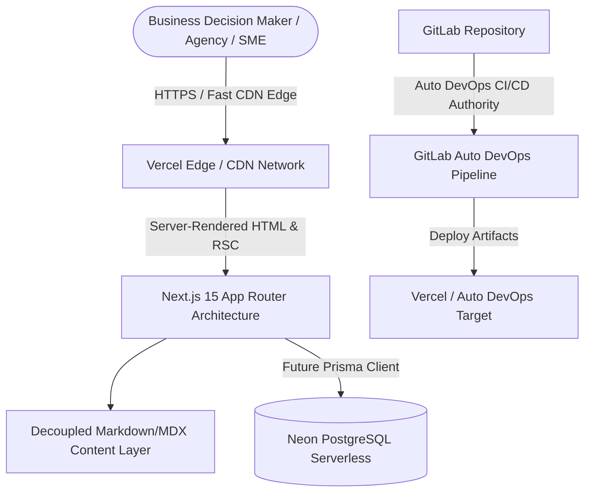

# Picksy Architecture Specification

> **Implementation status (Gate 2):** The live catalog uses typed, repository-managed records in `src/content/catalog.ts` behind `src/lib/catalog.ts`. It is intentionally empty until verified editorial and merchant inputs exist. Category and product routes are present but publish no pages from the empty catalog. MDX, Neon/Prisma, and ISR below describe possible future phases, not active integrations. The site remains `noindex` without a verified production origin. The explicit GitLab test override now runs `npm ci`, `npm test`, and `npm run build`; pipeline execution remains unverified.

> **Publication boundary:** Published catalog categories own their displayed name, description, and slug; static site configuration supplies planned cards and icons. An offer selects one merchant-owned approved destination by stable ID. The destination record holds the exact HTTPS URL and authorization-evidence reference. One active offer per product is allowed. Code checks structure and binding; editorial and merchant authorization still require human verification. Review dates are UTC calendar dates and must be ordered and no later than the UTC build date.

**Project:** Picksy  
**Document Version:** 1.0.0  
**Status:** Approved  
**Author:** Solution Architect, Engineering Architecture Panel

---

## 1. System Context & Overview

Picksy is an authority SaaS discovery, evaluation, and implementation advisory platform designed to help modern organizations—including agencies, consultants, SMEs, entrepreneurs, creators, and technical professionals—select and implement software solutions with confidence.



### 1.1 Core Strategic Principles

1. **Uncompromised Objectivity:** Editorial integrity and evidence-backed evaluation over commercial expediency.
2. **Speed & Accessibility:** Sub-second First Contentful Paint (FCP) and near-zero cumulative layout shift across mobile and desktop interfaces.
3. **Decoupled Architecture:** Clean boundary separation between content authoring, data modeling, API integration, and user presentation.
4. **GitOps & Pipeline Discipline:** **GitLab Auto DevOps is the authoritative CI/CD platform.** All deployment and build lifecycles defer to Auto DevOps standards.

---

## 2. Component Architecture & Application Layers

The application is architected using a modern layered pattern within the Next.js 15 App Router (`src/` directory convention):

```
src/
├── app/                  # Next.js 15 App Router: pages, layouts, routing, metadata
├── components/           # Atomic, domain-agnostic UI primitives (Buttons, Cards, Inputs)
├── features/             # Domain-specific vertical slices (e.g. comparison tables, review cards)
├── hooks/                # Reusable client-side React hooks
├── services/             # Business logic abstractions and external integrations
├── lib/                  # Shared utilities, formatting helpers, and runtime clients
├── config/               # Static site configuration, navigation, category schemas
└── types/                # Domain models and TypeScript type definitions
```

### Layer Responsibilities

| Layer             | Responsibility                                                                          | Isolation Rules                                            |
| ----------------- | --------------------------------------------------------------------------------------- | ---------------------------------------------------------- |
| **`app/`**        | Route handlers, root layouts, server component tree composition, metadata configuration | Minimal inline logic; defers to features and components.   |
| **`components/`** | Presentation-only UI components built to design system standards                        | Must not import services or database layers directly.      |
| **`features/`**   | Encapsulated feature slices grouping domain UI with feature-specific logic              | Features remain loosely coupled and self-contained.        |
| **`services/`**   | Data retrieval, content fetching, and external API coordination                         | Acts as intermediary between storage/CMS and presentation. |
| **`lib/`**        | Reusable utilities, math/string helpers, type guards, and core clients                  | Pure functions and singletons with zero UI dependencies.   |
| **`config/`**     | Site metadata, navigation trees, category classifications, and constants                | Static, immutable configuration maps.                      |
| **`types/`**      | Centralized TypeScript interfaces, types, and schema contracts                          | Type-only exports; zero runtime code.                      |

---

## 3. Content Architecture

Content is the primary business asset of Picksy. The content architecture is separated from code into the root `content/` hierarchy:

```
content/
├── blog/                 # Industry insights, software trends, and strategy articles
├── guides/               # In-depth, step-by-step implementation playbooks
├── reviews/              # Comprehensive evaluations (HighLevel, SE Ranking, systeme.io)
└── comparisons/          # Head-to-head feature, pricing, and workflow breakdowns
```

### Content Separation Principles

- **Phase 1 (Foundation):** Clean filesystem layout holding category taxonomy and metadata schemas.
- **Phase 2 (Content Ingestion):** Integration with frontmatter-validated MDX or headless CMS (e.g., Contentful/Sanity) using strict Zod schema validation.
- **Phase 3 (Dynamic Syndication):** Static Generation (SSG) with Incremental Static Regeneration (ISR) to cache review pages at the edge while allowing instant editorial updates.

---

## 4. Future Data Architecture (Neon PostgreSQL & Prisma)

While Phase 1 strictly avoids active database connections or runtime models, the database strategy is established:

```
prisma/
└── schema.prisma         # Declarative schema definition for Neon PostgreSQL
```

- **Target Database:** Neon PostgreSQL (Serverless, branchable PostgreSQL).
- **ORM:** Prisma ORM for type-safe query generation and migration management.
- **Connection Strategy:** Neon serverless connection pooling via `@prisma/adapter-neon` or pooled connection strings (`?sslmode=require&pgbouncer=true`).
- **Phase 1 Scope Boundary:** The `prisma/schema.prisma` file serves as a blueprint template. No migrations, database connections, or seed scripts are executed in Phase 1.

---

## 5. Security Architecture

Security is built into the repository foundation from day zero:

1. **Zero Secret Footprint:**
   - No credentials, tokens, or live URLs are committed to version control.
   - All runtime variables are declared as placeholders in `.env.example` with strict typing.
2. **Strict Content Security & Sanitation:**
   - All outbound affiliate and external links are enforced with `rel="noopener noreferrer"`.
   - Clear, compliant FTC Affiliate Disclosures positioned prominently across the platform.
3. **Dependency Integrity:**
   - Explicit version pinning in `package.json`.
   - Regular automated dependency auditing (`npm audit`).
   - Strict avoidance of untrusted third-party runtime bundles.
4. **Input & Validation Boundaries:**
   - Any future form submission or newsletter input will be validated using strict runtime schemas (Zod).

---

## 6. Deployment & CI/CD Topology

### 6.1 Picksy Guardian

Picksy Guardian is an event-driven Merge Request reviewer bot under
`tools/picksy-guardian/`. It is an independently deployed Node.js service whose
only package dependency is the `openai` SDK; it is not a Next.js route, a CI job, a database
integration, or a catalogue source, and it shares no code with `src/`.

GitLab delivers Merge Request webhooks to the service. Guardian authenticates
each delivery, then reads the Merge Request, diff and pipeline status from the
GitLab API with a dedicated bot account. It applies the deterministic checks
defined by `policy.json`, sends bounded, secret-redacted context to the OpenAI
Responses API for a schema-validated assessment, and creates or updates one
summary comment. A hidden marker in that comment records the project, Merge
Request, revision and policy version reviewed, so the service needs no
database. CI is a source of evidence for Guardian, not its controller.

Guardian can only comment. It cannot approve or merge requests, authorize
Gates, alter application code, deploy, or populate the production catalogue.
An unreviewable diff, an unavailable API, a refusal or a malformed AI response
is reported as INCONCLUSIVE, never as PASS. See
`tools/picksy-guardian/README.md` for the trust boundaries and threat model.

```
[Developer]
    │
    ▼ (git push feature/*)
[GitLab Remote Repository]
    │
    ▼ (Auto DevOps Trigger)
[GitLab Auto DevOps Execution Engine]
    ├── Code Quality & SAST Analysis
    ├── Buildpack Detection (Cloud Native Buildpacks / Node.js)
    ├── Automated Build (`npm run build`)
    └── Verification
    │
    ▼
[Target Environment: Vercel Edge / Production CDN]
```

### 6.1 Auto DevOps Authority

**GitLab Auto DevOps is the authoritative CI/CD platform.**

- `.gitlab-ci.yml` includes the standard Auto DevOps template and overrides its test job with Node.js 22, `npm ci`, `npm test`, and `npm run build`. Inherited build, security, and deployment behavior requires GitLab pipeline evidence.
- The project adheres to standard Node.js build conventions:
  - Standard `package.json` lifecycle scripts (`build`, `start`, `lint`).
  - Strict Node.js version declaration via `.nvmrc` and `engines` field in `package.json`.
  - Self-contained build artifact generation inside `.next/`.
